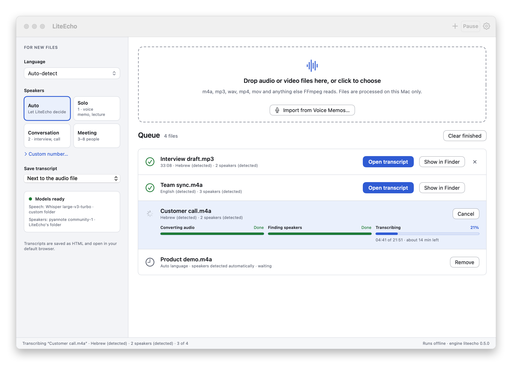
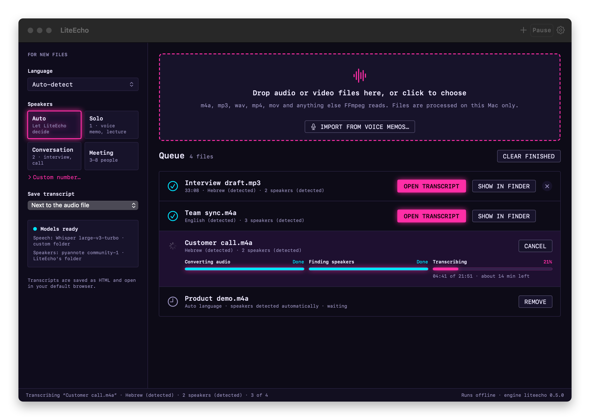
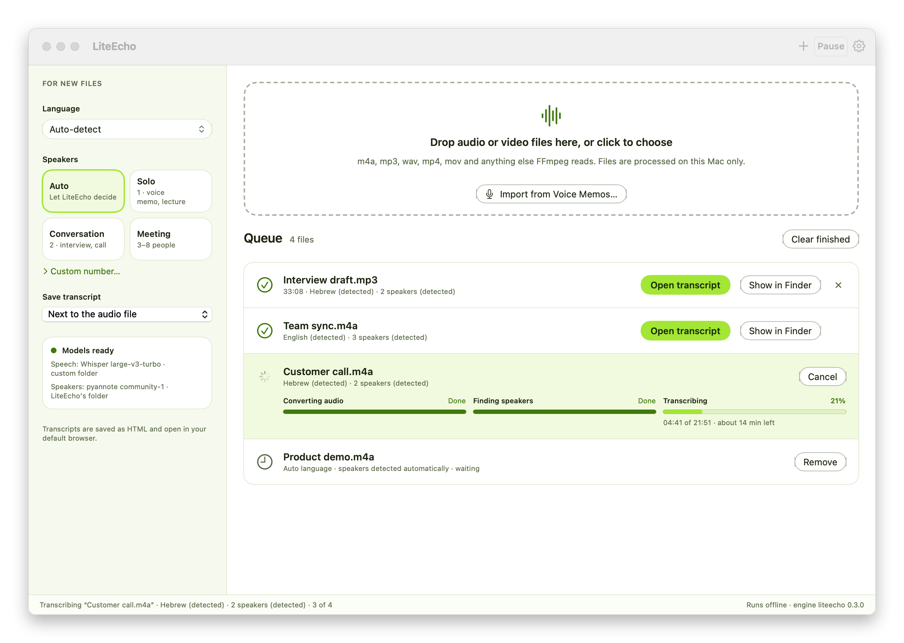
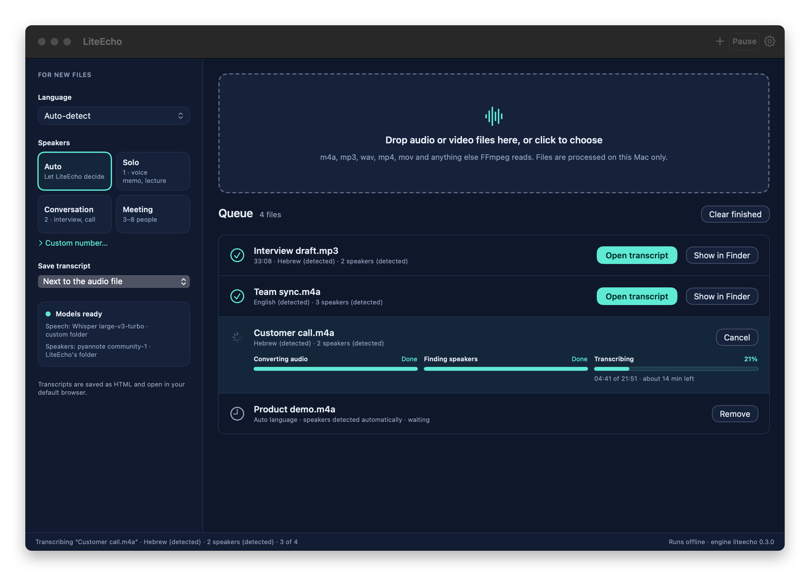
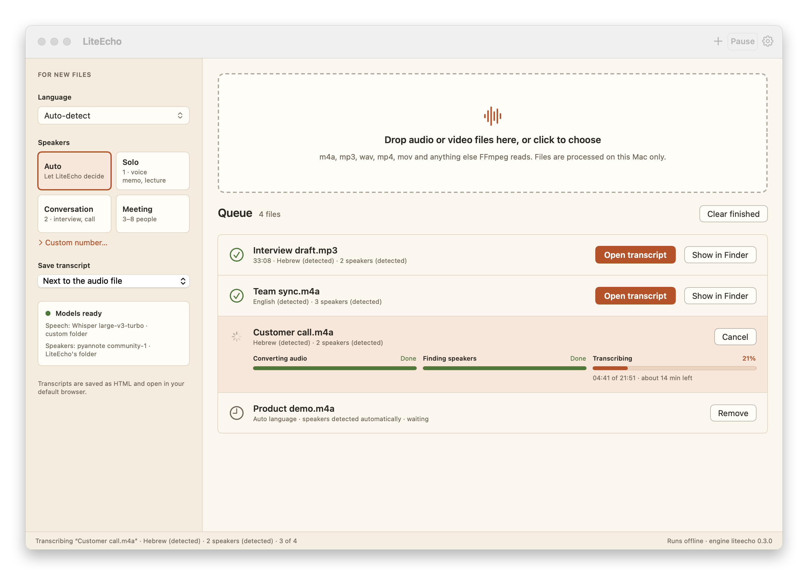
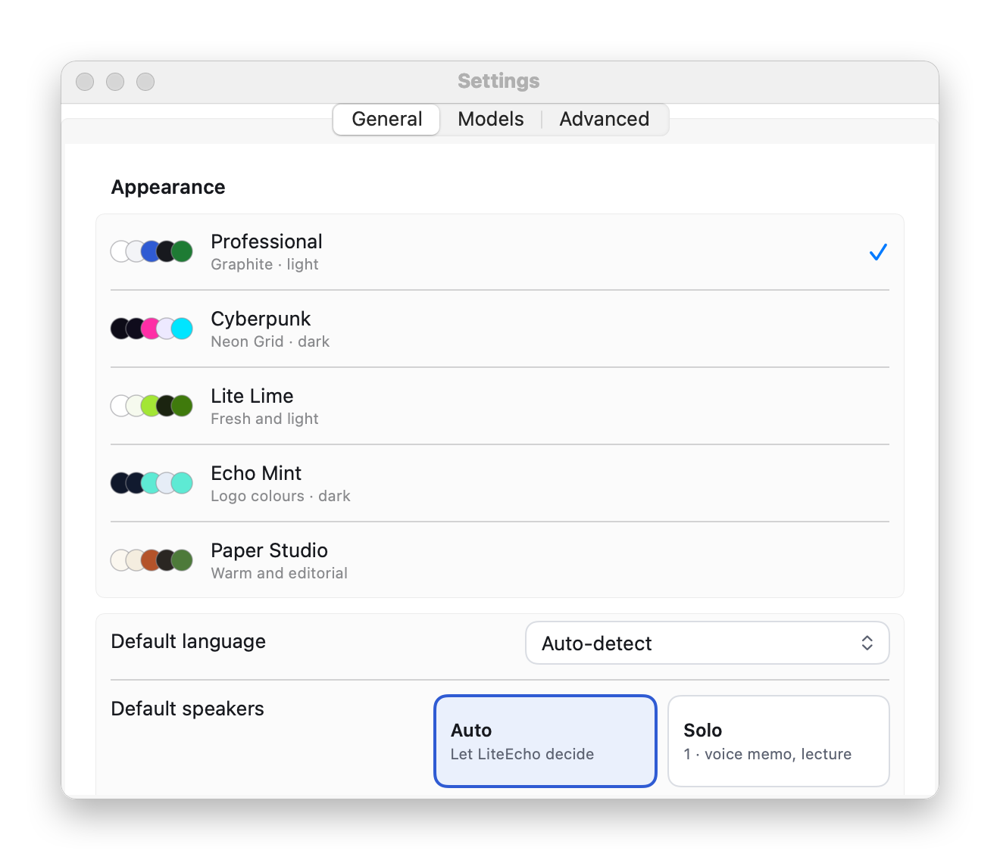
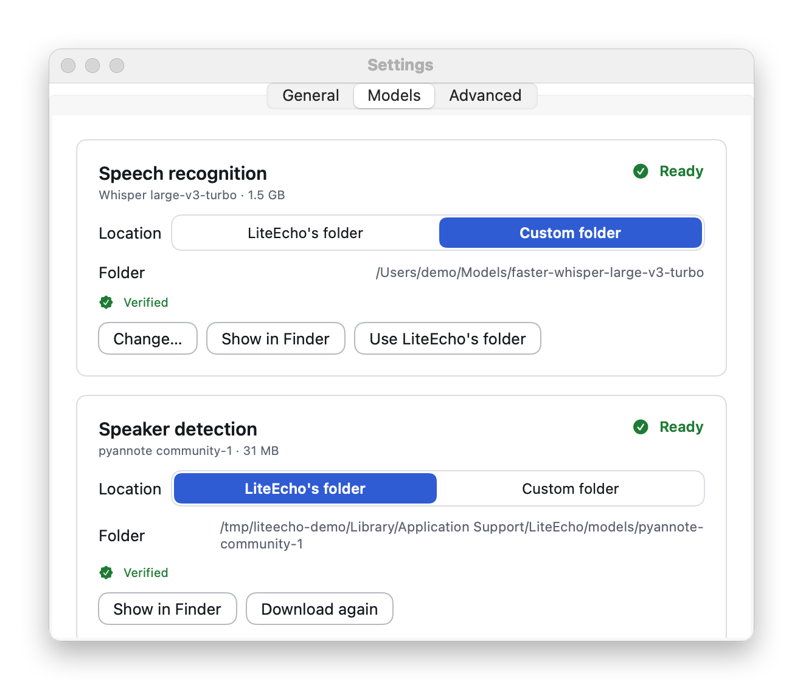
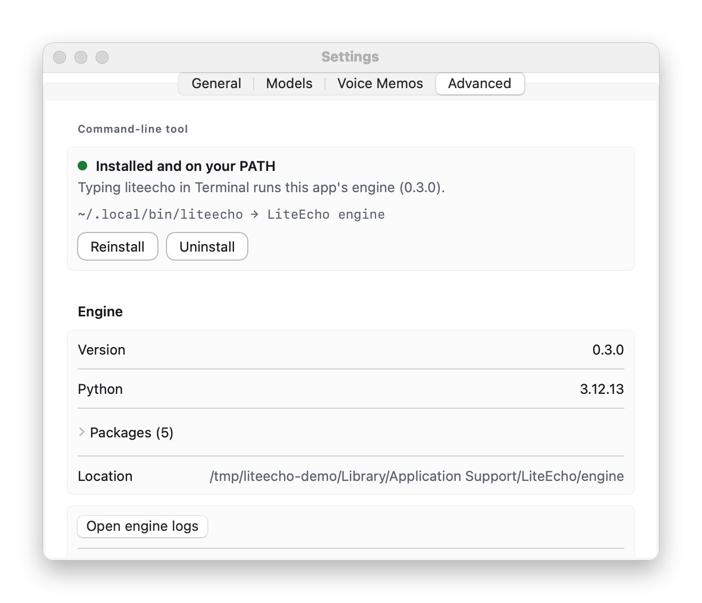
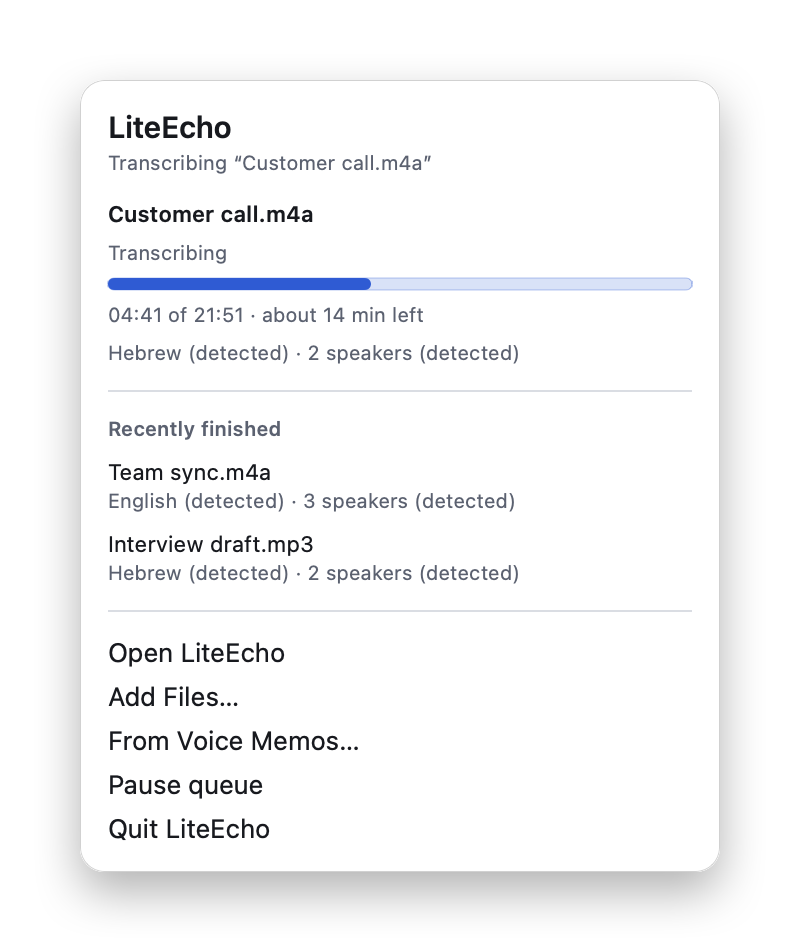
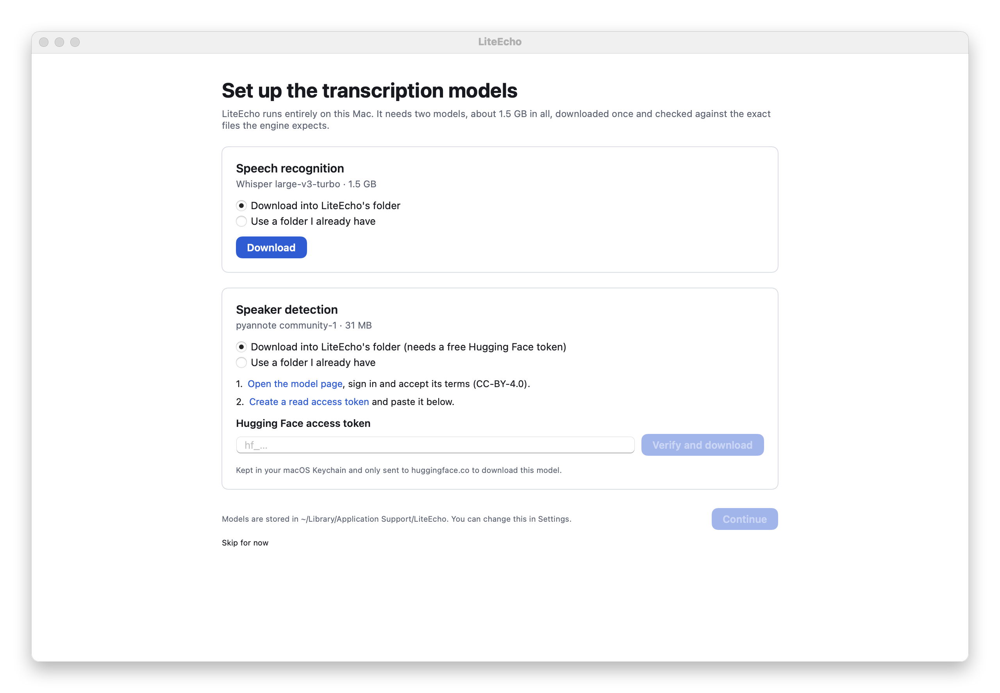

<p align="center"></p>

# LiteEcho

**Local transcription with speaker labels for macOS.** Drop in a recording and get a clean,
browser-ready HTML transcript showing who said what. It uses Whisper large-v3-turbo for speech and
pyannote community-1 for speakers, and runs entirely on your Mac.

- A native SwiftUI app with a queue, progress per stage, a menu bar item and notifications
- A `liteecho` command-line tool, using the same engine and the same models
- 100 languages with auto-detect, and tuned prompts for 66 of them
- Speaker presets (Solo, Conversation, Meeting) or an exact count or range
- Five themes; transcripts open in your default browser

## Screenshots

| | |
|---|---|
|  |  |
|  |  |
|  |  |
|  |  |



## Requirements

- macOS 14+ on Apple Silicon (arm64)
- About 1.6 GB of models: Whisper large-v3-turbo, and pyannote community-1 for speakers

## Install

1. Download `LiteEcho-<version>.dmg` from the latest [release](../../releases).
2. Open it and drag **LiteEcho** onto **Applications**.
3. Open LiteEcho. If the build isn't notarized, macOS blocks the first open:
   - On macOS 15 and later, go to System Settings › Privacy & Security and click **Open Anyway**
     next to "LiteEcho was blocked".
   - On macOS 14, right-click the app and choose **Open**.
   - Or, in Terminal: `xattr -dr com.apple.quarantine /Applications/LiteEcho.app`
4. First-run setup installs the engine and sets up the two models.

Each release also has a `.zip` of the app and a `.sha256` checksum for each download.

## Using the app

**First launch:** the app asks before installing its engine (about 1 GB, once) into
`~/Library/Application Support/LiteEcho/engine`. It builds the engine from the pinned requirements and
the wheel bundled in the app. Then, for each model, you choose:

- download it into LiteEcho's folder, or
- point at a folder you already have. Every file is checksum-verified before it is used.

**Using it:**

- **Language:** a searchable list of all 100 Whisper languages, with Auto-detect and your two most
  recent picks one click away. Languages marked *Tuned* come with a LiteEcho prompt for punctuation
  and style.
- **Speakers:** Auto, Solo (1), Conversation (2) or Meeting (3–8). *Custom number…* gives an exact
  count or a range.
- **Results:** transcripts are saved as HTML next to the audio, or in a folder you choose, and open in
  your default browser. To rename speakers, use *Rename Speakers…* in the context menu of a finished
  row.
- **Preferences** (gear button at the top right, or ⌘,):
  - Appearance: five themes (Professional, Cyberpunk, Lite Lime, Echo Mint, Paper Studio)
  - Model locations
  - The Hugging Face token, kept in the Keychain
  - The command-line tool, with a check of whether `liteecho` is on your PATH

## Command-line tool

```bash
uv sync
uv run liteecho INPUT [--output-folder DIR] [--language auto|CODE] [--speakers auto|N] \
                      [--min-speakers N] [--max-speakers N]
```

It writes `<output-folder>/<input stem>.html`; by default that is next to the input. Input is anything
FFmpeg can decode (m4a, mp3, wav, mp4, mov, …).

**Options:**

- `--language`: `auto` (default), any of the 100 Whisper language codes, or an English name (`Hebrew`)
- `--speakers`: `auto` or an exact number (1–20)
- `--min-speakers` / `--max-speakers`: a range for the speaker count. You can't combine it with an
  exact number.
- `--whisper-dir`, `--pyannote-dir`: the folder of one model (env: `LITEECHO_WHISPER_DIR`,
  `LITEECHO_PYANNOTE_DIR`)
- `--models-dir`: a models folder holding both (env: `LITEECHO_MODELS`)
- `--events jsonl`: no progress bars. Stdout carries only JSON lines (`stage`, `speakers`,
  `language`, `done`, `error`); logs stay on stderr.

**Where models come from:** each model is resolved separately, in this order:

1. its own folder (`--whisper-dir` or `--pyannote-dir`)
2. `--models-dir`
3. the cache at `~/Library/Application Support/LiteEcho/models` (`LITEECHO_CACHE` overrides)

### Getting the models

```bash
liteecho fetch-models                 # download into the cache, checking every file's SHA-256
liteecho fetch-models --from DIR      # or import from a local folder, with the same checks
```

The speaker model (`pyannote/speaker-diarization-community-1`) is free but gated. Accept its terms on
[its Hugging Face page](https://huggingface.co/pyannote/speaker-diarization-community-1), then run
`hf auth login` or set `HF_TOKEN`. Use `--only whisper|pyannote` to fetch one model, and `--force` to
download again.

### Other commands

```
liteecho engine-info --json [--verify] [--whisper-dir DIR] [--pyannote-dir DIR]
liteecho rename-speakers FILE.html --map S1=Dana --map S2=Avi [--events jsonl]
```

- **`engine-info`** prints:
  - the engine version and package versions
  - where each model resolves (`custom`, `cache` or `missing`) and, with `--verify`, whether its
    files match the pinned checksums
  - the supported languages
- **`rename-speakers`** sets the display name for a speaker ID. Names are trimmed and sanitised, then
  escaped, and the file is replaced atomically.
- **Stopping:** SIGTERM stops a running job like Ctrl-C: workers end, temp files are removed, and the
  exit code is 143.

## Transcript format

Each transcript is one self-contained, well-formed HTML file with no scripts. Its Content Security
Policy blocks all scripts and external loads. Metadata sits in `liteecho:*` meta tags, and each turn
of speech is a `<section class="turn" data-speaker="S1">`. Right-to-left languages, dark mode and
printing are supported. The full contract is in [docs/transcript-format.md](docs/transcript-format.md).

## Development

To build from source, run the tests or make a release, see [DEVELOPMENT.md](DEVELOPMENT.md).

## License

[Apache-2.0](LICENSE).
